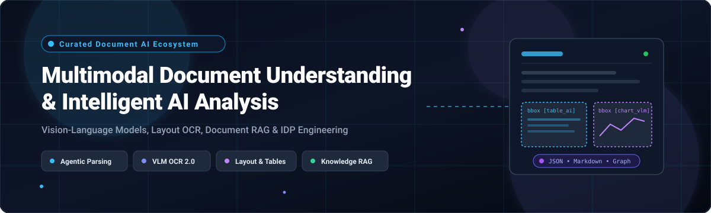

  

# 📑 Awesome Multimodal Document Understanding & AI Analysis 🚀

  
  
  
  
  
  

---

## 🌟 Overview & Ecosystem

Welcome to the ultimate curated list of **Multimodal Document Understanding & Intelligent Document Processing (IDP)** solutions. This repository provides AI researchers, machine learning engineers, and RAG practitioners with an exhaustive directory of state-of-the-art **Vision-Language Models (VLMs)**, **OCR engines**, **layout analysis frameworks**, and **enterprise document extraction platforms**.

Whether parsing complex research PDFs, scanned corporate invoices, multi-column scientific literature, or complex nested tables, this guide covers the entire spectrum from production SaaS APIs to self-hosted open-source document AI models.

---

## 📊 Sector Overview & Market Dynamics

> The global Intelligent Document Processing (IDP) and multimodal document analysis market is valued at approximately **$3.17B – $4.1B in 2026** and is projected to surge past **$12.35B by 2030** at an accelerated CAGR of over **32%**.  
> The sector is **moderately fragmented** rather than winner-take-all: while hyperscalers (Microsoft, AWS, Google) command broad commodity OCR and cloud extraction layers, specialized pure-play IDP vendors (Hyperscience, Rossum) and specialized agentic vision-first startups (Landing AI, Scale AI) capture substantial high-margin enterprise market share by excelling at zero-human-in-the-loop workflows, domain-specific compliance, and complex multi-modal reasoning.

---

## 📑 Table of Contents
- [📊 Sector Overview & Market Dynamics](#-sector-overview--market-dynamics)
- [🏢 SaaS & Hosted Platforms](#-saas--hosted-platforms)
- [💻 Open-Source GitHub Projects](#-open-source-github-projects)
- [🤝 How to Contribute](#-how-to-contribute)
- [📈 Star History](#-star-history)
- [💖 Support & Community](#-support--community)
- [📜 Disclaimer](#-disclaimer)

---

## 🏢 SaaS & Hosted Platforms

The table below catalogs enterprise SaaS document intelligence platforms, sorted in descending order by company scale (market capitalization, private valuation, or institutional ARR):

| Platform | Company Scale (Valuation / Revenue) | Pricing (Starting Tier) | Free Tier / Trial Limits | Key Capabilities |
| :--- | :--- | :--- | :--- | :--- |
| **[Azure AI Document Intelligence](https://microsoft.com)** | **$3.1+ Trillion** (Microsoft Market Cap) | Pay-as-you-go (S0 tier): Read/OCR starts at $1.50 per 1,000 pages ($0.0015/page); Prebuilt models start at $10.00 per 1,000 pages ($0.01/page) | Free (F0) tier forever: 500 pages per month (first 2 pages per multi-page document, max 1 transaction/second) | Cloud document analysis service offering layout-to-Markdown conversion, prebuilt financial/ID models, and custom neural extraction templates. |
| **[Google Cloud Document AI](https://google.com)** | **$2.1+ Trillion** (Alphabet Market Cap) | Pay-as-you-go: Enterprise Document OCR starts at $1.50 per 1,000 pages ($0.0015/page); Form Parser at $30.00 per 1,000 pages ($0.03/page) | 1,000 pages per month free forever for Enterprise Document OCR (plus $300 new GCP customer trial credits) | Managed enterprise document understanding platform combining layout parsing, custom entity extraction, invoice/receipt processors, and Gemini multimodal grounding. |
| **[AWS Textract](https://amazon.com)** | **$2.0+ Trillion** (Amazon Market Cap) | Pay-as-you-go: Detect Document Text starts at $0.0015/page ($1.50/1k pages); Analyze Expense at $0.01/page; Tables at $0.015/page | 3-month free trial: 1,000 pages/month for Detect Document Text, 100 pages/month for Analyze Document (Tables/Forms) and Analyze Expense | Cloud machine learning service that automatically extracts printed text, handwriting, key-value forms, and complex tables from scanned documents. |
| **[Scale Document AI (Scale AI)](https://scale.com)** | **$29 Billion** (Valuation, Series F & Meta Strategic) | Self-serve annotation/labeling starts at $0.05 per task/unit; Enterprise Document AI contracts typically start at ~$93,000/year | Free tier for self-labeling engine: 200 free units per month; Enterprise evaluation via sales demo/PoC (no permanent free tier for enterprise IDP) | Enterprise generative AI and human-in-the-loop document processing platform engineered for high-accuracy extraction across unstructured enterprise records. |
| **[Hyperscience](https://hyperscience.com)** | **$1.6 Billion** (Valuation; ~$50M–$100M ARR) | Custom enterprise annual contracts, typically starting at ~$150,000/year based on document volume and deployment model | Free proof of concept (PoC) / guided demo sandbox for prospective enterprise evaluations (no self-serve free tier or public trial) | Enterprise hyperautomation and AI document processing platform specializing in messy handwriting recognition and human-in-the-loop quality assurance. |
| **[Rossum](https://rossum.ai)** | **$500 Million** (Valuation, acquired by Coupa; ~$22M ARR) | Starter annual plan starts at $18,000/year ($1,500/month equivalent); scales with page volume commitments | 14-day free trial (full access to Rossum Aurora AI engine, document queues, and validation up to 300 trial documents; no credit card required) | Cloud-native cognitive Intelligent Document Processing (IDP) platform powered by transactional LLMs for automated invoice, purchase order, and logistics workflows. |
| **[Landing AI (Agentic Document Extraction)](https://landing.ai)** | **$300M – $500M** (Estimated Valuation; ~$34M ARR) | Pay-as-you-go: $0.01/credit ($1 for 100 credits); Team plan starts at $250/month | 1,000 free credits on signup (Explore plan, valid for 90 days, no credit card required) | Visual-first multimodal document AI platform built by Andrew Ng's team, extracting structured JSON and grounded bounding-box citations from complex charts, tables, and diagrams. |
| **[ABBYY Vantage](https://abbyy.com)** | **$300M+** (Majority buyout by Marlin Equity; $100M+ Revenue) | Metered volume-based licensing: 100k–500k pages/year rates at ~$0.04 to $0.08/page; base platform annual contracts start at ~$15,000 to $30,000/year | Guided evaluation trial tenant (14 to 30 days upon request, restricted volume quota for testing pre-trained cognitive skills; no self-serve free tier) | Low-code cloud Intelligent Document Processing suite combining industry-standard FineReader OCR with pre-trained cognitive document skills. |
| **[Klippa DocHorizon](https://klippa.com)** | **~$50M – $80M** (Estimated Exit to Doxis; ~$21.5M ARR) | Pay-as-you-go credit wallet model; modular finished products like SpendControl start at €95/month; API volume tiers vary by module | €25 in complimentary trial credits upon developer account creation for testing OCR and extraction APIs (no permanent free tier) | Cloud IDP and OCR API platform offering automated data extraction, document classification, anonymization, and fraud detection. |
| **[Veryfi OCR API](https://veryfi.com)** | **~$35M – $50M** (Estimated Valuation; ~$6M–$13M ARR) | Production Starter plan starts at $500/month minimum spend (~$0.08 per receipt, ~$0.16 per invoice); Growth tiers scale with volume | Free tier forever: 100 documents per month (up to 15 pages per document, full access to 100+ document APIs) + 14-day free trial for higher features | Real-time, zero-human-in-the-loop multimodal OCR API delivering sub-second structured JSON extraction for receipts, invoices, checks, and W-2s. |

---

## 💻 Open-Source GitHub Projects

Explore the top open-source document parsing, layout recognition, and vision-language extraction repositories. Entries are strictly sorted in descending order by GitHub_Stars_Count:

1. **[Egonex-AI/Understand-Anything](https://github.com/Egonex-AI/Understand-Anything)**   
   *Turn any complex document, code, or unstructured media into interactive multimodal knowledge graphs and grounded vectors for advanced reasoning.*

2. **[PaddlePaddle/PaddleOCR](https://github.com/PaddlePaddle/PaddleOCR)**   
   *Industry-leading multilingual OCR toolkit and PP-Structure suite supporting 100+ languages, layout analysis, table recovery, and key-information extraction.*

3. **[opendatalab/MinerU](https://github.com/opendatalab/MinerU)**   
   *High-precision multimodal PDF converter translating complex multi-column layouts, LaTeX equations, and tables into clean Markdown/JSON for agentic workflows.*

4. **[tesseract-ocr/tesseract](https://github.com/tesseract-ocr/tesseract)**   
   *The classic, battle-tested open-source LSTM-based OCR engine supporting over 100 languages that serves as the foundation for modern document pipelines.*

5. **[docling-project/docling](https://github.com/docling-project/docling)**   
   *IBM Research's premier toolkit parsing PDFs, DOCX, PPTX, and HTML with advanced layout analysis, TableFormer table structure recovery, and native LlamaIndex/LangChain connectors.*

6. **[paperless-ngx/paperless-ngx](https://github.com/paperless-ngx/paperless-ngx)**   
   *A community-supported, supercharged document management system featuring automated OCR indexing, machine-learning document tagging, and full-text search.*

7. **[datalab-to/marker](https://github.com/datalab-to/marker)**   
   *Fast, deep-learning pipeline converting PDFs, books, and scientific papers into clean Markdown, JSON, and HTML with equation and layout preservation.*

8. **[google/langextract](https://github.com/google/langextract)**   
   *Google's Python library for extracting structured information from unstructured text and documents with precise source grounding, character offsets, and interactive visualizations.*

9. **[JaidedAI/EasyOCR](https://github.com/JaidedAI/EasyOCR)**   
   *Ready-to-use deep learning OCR framework supporting 80+ languages and popular writing scripts (Latin, Chinese, Arabic, Devanagari, Cyrillic) in PyTorch.*

10. **[microsoft/unilm (LayoutLMv1/v2/v3)](https://github.com/microsoft/unilm)**   
    *Foundational multimodal document transformers pre-trained jointly on text, visual patches, and 2D bounding boxes for scanned document parsing and receipt understanding.*

11. **[datalab-to/surya](https://github.com/datalab-to/surya)**   
    *Multilingual document OCR, line-level text detection, layout analysis, reading-order recognition, and table structure detection in 90+ languages.*

12. **[allenai/olmocr](https://github.com/allenai/olmocr)**   
    *Allen Institute for AI (Ai2)'s Vision-Language Model toolkit fine-tuned specifically to linearize complex, multi-column scientific PDFs and messy documents into Markdown.*

13. **[Unstructured-IO/unstructured](https://github.com/Unstructured-IO/unstructured)**   
    *Ubiquitous open-source ETL ingestion library for partitioning, cleaning, and transforming PDFs, Word files, and presentations into structured RAG chunks.*

14. **[getomni-ai/zerox](https://github.com/getomni-ai/zerox)**   
    *Zero-shot OCR and document extraction utility utilizing Vision LLMs (GPT-4o, Claude 3.5 Sonnet) to convert complex PDF pages and forms into Markdown.*

15. **[pymupdf/PyMuPDF](https://github.com/pymupdf/PyMuPDF)**   
    *High-performance document processing engine with ML-based layout analysis that converts PDFs and Office documents into high-quality Markdown grounded to source coordinates.*

16. **[py-pdf/pypdf](https://github.com/py-pdf/pypdf)**   
    *Pure-Python PDF manipulation and text extraction library for splitting, merging, cropping, and transforming document pages.*

17. **[facebookresearch/nougat](https://github.com/facebookresearch/nougat)**   
    *Meta AI's Neural Optical Understanding for Academic Documents; an end-to-end visual transformer parsing academic PDFs directly into LaTeX math and Markdown.*

18. **[Ucas-HaoranWei/GOT-OCR2.0](https://github.com/Ucas-HaoranWei/GOT-OCR2.0)**   
    *Unified General OCR Theory (OCR-2.0) vision-language model capable of parsing plain text, mathematical formulas, molecular diagrams, sheet music, and tables.*

19. **[The-Vibe-Company/megaparse](https://github.com/The-Vibe-Company/megaparse)**   
    *File parser optimized for LLM ingestion with zero information loss; parses PDFs, DOCX, and PPTX while maintaining layout hierarchy and tables.*

20. **[adbar/trafilatura](https://github.com/adbar/trafilatura)**   
    *Python web scraping and document extraction library tailored for gathering clean, readable body text and structured metadata from web documents.*

21. **[pdfminer/pdfminer.six](https://github.com/pdfminer/pdfminer.six)**   
    *Community-maintained Python PDF parser focusing on exact layout reconstruction, font extraction, and visual bounding boxes.*

22. **[clovaai/donut](https://github.com/clovaai/donut)**   
    *OCR-free Document Understanding Transformer performing end-to-end visual document classification, key-information parsing, and DocVQA without OCR.*

23. **[mindee/doctr](https://github.com/mindee/doctr)**   
    *Seamless, high-performing 2-stage OCR and document parsing library powered by PyTorch and TensorFlow for enterprise IDP pipelines.*

24. **[run-llama/llama_cloud_services (LlamaParse)](https://github.com/run-llama/llama_cloud_services)**   
    *Multimodal document parsing client for LlamaIndex that preserves tables, hierarchies, and embedded charts for high-precision RAG embeddings.*

25. **[chrismattmann/tika-python](https://github.com/chrismattmann/tika-python)**   
    *Python binding to Apache Tika REST services, enabling content and metadata extraction from thousands of file formats.*

26. **[enoch3712/ExtractThinker](https://github.com/enoch3712/ExtractThinker)**   
    *Document intelligence library for LLMs offering ORM-style interaction with Pydantic contracts and hybrid OCR/VLM routers.*

27. **[VikParuchuri/texify](https://github.com/VikParuchuri/texify)**   
    *Specialized math OCR model that parses handwritten and printed mathematical formulas directly into clean LaTeX and Markdown.*

28. **[AnswerDotAI/byaldi](https://github.com/AnswerDotAI/byaldi)**   
    *ColPali late-interaction multimodal document retrieval framework indexing raw PDF page images directly via multi-vector embeddings.*

29. **[google-research/pix2struct](https://github.com/google-research/pix2struct)**   
    *Pre-trained image-to-text visual language model for visual document understanding, web UI comprehension, and chart reading.*

---

## 🤝 How to Contribute

Contributions from the AI and developer community are warmly welcome! 🚀

1. 🍴 **Fork the repository** on GitHub.
2. 🌿 **Create a new branch** (`git checkout -b feature/add-new-parser`).
3. 📝 **Add your entry** to either the SaaS table or Open-Source list (ensure factual descriptions, links, and accurate metadata).
4. 📬 **Submit a Pull Request** with a concise summary of the addition.

---

## 📈 Star History

---

## 💖 Support & Community

Thank you for exploring this curated repository! If you find this resource helpful for your AI research, production workflows, or open-source projects, please consider supporting the project:

- ⭐ **Star this repository** to help others discover it.
- 🍴 **Fork and contribute** your favorite tools and models.
- 📢 **Share with your network** on X/Twitter, LinkedIn, and developer communities.
- ☕ **Buy me a coffee**: Support ongoing maintenance and curated updates via the [GitHub Sponsors Dashboard](https://github.com/sponsors/ishandutta2007).

---

## 📜 Disclaimer

*This list is community-curated and provided for informational and educational purposes. Mentions do not constitute an official endorsement, and pricing/metrics are subject to change by their respective vendors.*
